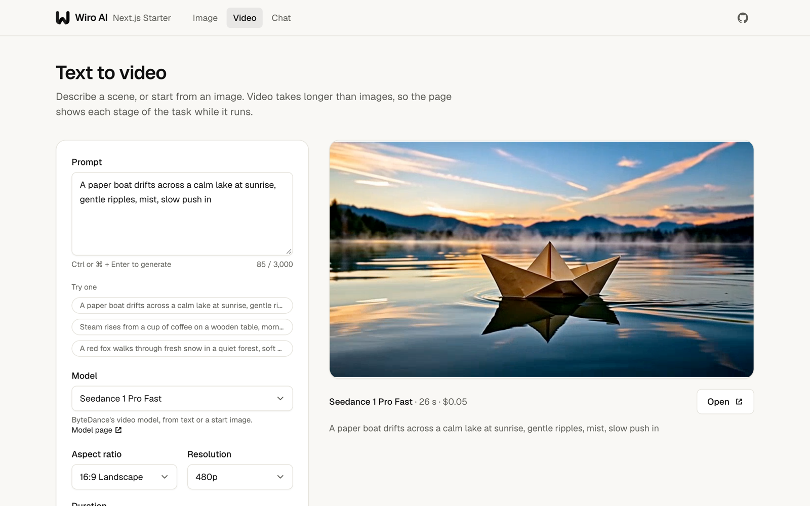

<div align="center">


# Wiro AI Next.js Starter

A Next.js app with three working pages on Wiro AI: text to image, text to video with live progress, and a streaming LLM chat built with the Vercel AI SDK.

[](https://nextjs.org) [](https://ai-sdk.dev) [](https://github.com/wiroai/Wiro-Next-Starter/actions/workflows/ci.yml) [](./LICENSE)

[Website](https://wiro.ai) · [Models](https://wiro.ai/models) · [Docs](https://wiro.ai/docs) · [Dashboard](https://wiro.ai/panel)


[](https://vercel.com/new/clone?repository-url=https%3A%2F%2Fgithub.com%2Fwiroai%2FWiro-Next-Starter&env=WIRO_API_KEY&envDescription=API%20key%20of%20your%20Wiro%20AI%20project&envLink=https%3A%2F%2Fwiro.ai%2Fdocs%2Fauthentication&project-name=wiro-next-starter&repository-name=wiro-next-starter) [](#deploy-on-railway)

</div>

This starter shows how to call [Wiro AI](https://wiro.ai) from a Next.js App Router app. Images and videos go through the Wiro AI Run API: a route handler starts a task with `POST /Run/{owner}/{model}`, and the page polls the task until the file is ready. The chat streams answers from the Wiro LLM gateway at `https://llm.wiro.ai/v1` with the AI SDK and [`@wiro-ai/wiro-llm`](https://github.com/wiroai/Wiro-LLM). Every call to Wiro AI runs on the server, so your API key never reaches the browser.


## What's inside

- **Text to image** with P-Image, GPT Image 2, Nano Banana 2 and Seedream 4.5. Pick a model, an aspect ratio and the model's own options.
- **Text to video** with Seedance 1 Pro Fast, Kling 3 and Veo 3.1 Fast. The page shows each stage of the task (queued, preparing, generating, saving) with a timer, then plays the clip. Start from a prompt, or from an image: the **Animate** button under an image result opens the video page with that image as the first frame.
- **Chat** with GPT-5.4 Nano, GPT-5.4 Mini, Gemini 3.5 Flash-Lite, DeepSeek V4.1 Flash and Claude Sonnet 5, built on `useChat` from the AI SDK. Answers render as Markdown, and each reply shows what it cost.
- **Server-side calls only.** Three route handlers talk to Wiro AI. They run only the models listed in `lib/models.ts`, with the choices listed there.
- **Optional password.** Set `BASIC_AUTH_PASSWORD` to keep a deployment to yourself.
- Next.js 16 with the App Router, React 19, TypeScript, Tailwind CSS 4, light and dark themes, ESLint, Prettier and Vitest.

## Deploy

You need a Wiro AI project. Create one at [wiro.ai/panel/project/new](https://wiro.ai/panel/project/new) and copy its API key. If you choose signature authentication for the project, copy the API secret too.

### Deploy with Vercel

Click **Deploy with Vercel** above. Vercel copies this repository to your GitHub account, asks for `WIRO_API_KEY` and deploys the app. For a signature project, add `WIRO_API_SECRET` afterwards under **Settings → Environment Variables** and redeploy.

### Deploy on Railway

1. Fork this repository.
2. In Railway, choose **New Project → Deploy from GitHub repo** and pick your fork.
3. Under **Variables**, add `WIRO_API_KEY`, and `WIRO_API_SECRET` for a signature project.
4. Under **Settings → Networking**, click **Generate Domain**.

Railway builds the app with Railpack, which reads `package.json`: it runs `npm run build`, starts the app with `npm start` and takes the Node.js version from `engines`. `next start` listens on the `PORT` that Railway sets, so no Railway config file is needed. If you add a healthcheck, use `/`.

### Other hosts

`npm run build` and `npm start` run the app on any host with Node.js 22 or later.

## Run it locally

```bash
git clone https://github.com/wiroai/Wiro-Next-Starter.git
cd Wiro-Next-Starter
npm install
cp .env.example .env.local
```

Put your key in `.env.local`, then start the dev server and open [http://localhost:3000](http://localhost:3000):

```bash
npm run dev
```

## Environment variables

| Variable              | Required               | What it does                                                                                                       |
| --------------------- | ---------------------- | ------------------------------------------------------------------------------------------------------------------ |
| `WIRO_API_KEY`        | Yes                    | API key of your Wiro AI project                                                                                    |
| `WIRO_API_SECRET`     | For signature projects | API secret of the same project. Run API requests are signed with it, and the LLM gateway gets `API_KEY:API_SECRET` |
| `BASIC_AUTH_PASSWORD` | No                     | When set, the browser asks for this password before it opens any page. Any user name works                         |

The app reads these on the server when a request comes in, so a build works without them. None of them starts with `NEXT_PUBLIC_`, so Next.js never sends them to the browser.

## How it works

```text
Browser                         This app (route handlers)              Wiro AI
POST /api/runs             ->   check the model and settings     ->    POST /Run/{owner}/{model}
                           <-   { token }
GET /api/tasks/{token}     ->   read the task                    ->    POST /Task/Detail
  (every 1.5 s or 3 s)     <-   stage, output URLs, time, cost
POST /api/chat             ->   streamText(wiro(model))          ->    llm.wiro.ai/v1/chat/completions
                           <-   streamed reply, model and cost
```

| File                             | What it does                                                                                                                                                                      |
| -------------------------------- | --------------------------------------------------------------------------------------------------------------------------------------------------------------------------------- |
| `app/api/runs/route.ts`          | Checks the request against `lib/models.ts` and starts a task with [`POST /Run/{owner}/{model}`](https://wiro.ai/docs/run-a-model). Returns only the task token.                   |
| `app/api/tasks/[token]/route.ts` | Reads the task with [`POST /Task/Detail`](https://wiro.ai/docs/tasks) and returns its stage, output URLs, time and cost.                                                          |
| `app/api/chat/route.ts`          | Streams a reply from the [Wiro LLM gateway](https://wiro.ai/docs/completions-api) with `streamText` and `@wiro-ai/wiro-llm`, and adds the model and cost to the message metadata. |
| `lib/wiro.ts`                    | The Run API client: authentication headers, errors and task reads. It imports `server-only`, so it can't end up in browser code.                                                  |
| `lib/models.ts`                  | The models the app offers and their settings.                                                                                                                                     |
| `lib/tasks.ts`                   | Turns Wiro AI task statuses into the stages the page shows.                                                                                                                       |
| `lib/use-task-run.ts`            | The React hook that starts a task and polls it.                                                                                                                                   |
| `proxy.ts`                       | The optional password.                                                                                                                                                            |

A task is finished when its status is `task_postprocess_end`, with `pexit` `"0"` on success, or `task_cancel`; see [Tasks](https://wiro.ai/docs/tasks). The browser only ever gets the task token, never the numeric task ID.

Projects that use signature authentication send `x-nonce` and `x-signature` with every Run API request, where the signature is HMAC-SHA256 of the API secret plus the nonce, keyed with the API key. See [Authentication](https://wiro.ai/docs/authentication).





## Models

| Page  | Model                                                                        | ID                               |
| ----- | ---------------------------------------------------------------------------- | -------------------------------- |
| Image | [P-Image](https://wiro.ai/models/pruna/p-image)                              | `pruna/p-image`                  |
| Image | [GPT Image 2](https://wiro.ai/models/openai/gpt-image-2)                     | `openai/gpt-image-2`             |
| Image | [Nano Banana 2](https://wiro.ai/models/google/nano-banana-2)                 | `google/nano-banana-2`           |
| Image | [Seedream 4.5](https://wiro.ai/models/bytedance/seedream-v4-5)               | `bytedance/seedream-v4-5`        |
| Video | [Seedance 1 Pro Fast](https://wiro.ai/models/bytedance/seedance-v1-pro-fast) | `bytedance/seedance-v1-pro-fast` |
| Video | [Kling 3](https://wiro.ai/models/klingai/kling-v3)                           | `klingai/kling-v3`               |
| Video | [Veo 3.1 Fast](https://wiro.ai/models/google/veo3-1-fast)                    | `google/veo3-1-fast`             |
| Chat  | [GPT-5.4 Nano](https://wiro.ai/models/openai/gpt-5-4-nano)                   | `openai/gpt-5-4-nano`            |
| Chat  | [GPT-5.4 Mini](https://wiro.ai/models/openai/gpt-5-4-mini)                   | `openai/gpt-5-4-mini`            |
| Chat  | [Gemini 3.5 Flash-Lite](https://wiro.ai/models/google/gemini-3-5-flash-lite) | `google/gemini-3-5-flash-lite`   |
| Chat  | [DeepSeek V4.1 Flash](https://wiro.ai/models/deepseek/v4-1-flash)            | `deepseek/v4-1-flash`            |
| Chat  | [Claude Sonnet 5](https://wiro.ai/models/claude/sonnet-5)                    | `claude/sonnet-5`                |

### Add a model

The Wiro AI catalog has 1,000+ models. Find one on [wiro.ai/models](https://wiro.ai/models): its page URL gives the ID (`https://wiro.ai/models/google/nano-banana-pro` becomes `google/nano-banana-pro`), and [`POST /Tool/Detail`](https://wiro.ai/docs/models) lists its parameters and their choices. Then add an entry to `imageModels` or `videoModels` in `lib/models.ts`:

```ts
{
  id: 'google/nano-banana-pro',
  name: 'Nano Banana Pro',
  description: "Google's image model.",
  settings: [ratios('aspectRatio', ['1:1', '16:9', '9:16'], '1:1')],
},
```

Each setting's `id` is a parameter name, and the server sends only the choices you list. `fixed` holds parameters sent with every run, such as `samples: '1'` for GPT Image 2. Video models that take a start frame name that parameter in `imageInput`. Chat models go in `chatModels`, with an ID from [`GET https://llm.wiro.ai/v1/models`](https://wiro.ai/docs/completions-api).

## Before you share a deployment

Anyone who can open your deployment can run models with your key. To keep that in check:

- Set `BASIC_AUTH_PASSWORD`, or put your own sign-in in front of the app.
- Keep `lib/models.ts` to the models you want to offer. The route handlers refuse every other model and setting, and they cap the length of prompts and chat messages.
- Use a key from a project in a Wiro AI team with a spend limit and model access controls. See [Team billing](https://wiro.ai/docs/organizations-billing).

## Development

```bash
npm run dev        # dev server on http://localhost:3000
npm run check      # format check, lint, type check and tests
npm run build      # production build
npm start          # serve the production build
```

The tests cover the Run API client, request signing, task status mapping, the three route handlers and the password check. They use a mocked `fetch` and make no network calls. CI runs them with the format check, lint, type check and build on Node.js 22 and 24.

## Costs

Each run is billed to your Wiro AI account at the model's price, which is listed on its model page. Only successful tasks are billed. The app shows the billed amount under every image, video and chat reply.

## More from Wiro AI

| Repository                                                                   | What it is                                                                                                                               |
| ---------------------------------------------------------------------------- | ---------------------------------------------------------------------------------------------------------------------------------------- |
| [Wiro-MCP](https://github.com/wiroai/Wiro-MCP)                               | Official MCP server for Wiro AI, [`@wiro-ai/wiro-mcp` on npm](https://www.npmjs.com/package/@wiro-ai/wiro-mcp)                           |
| [Wiro-LLM](https://github.com/wiroai/Wiro-LLM)                               | Wiro AI provider for the Vercel AI SDK, [`@wiro-ai/wiro-llm` on npm](https://www.npmjs.com/package/@wiro-ai/wiro-llm)                    |
| [Wiro-Plugin](https://github.com/wiroai/Wiro-Plugin)                         | Wiro AI plugin for Cursor, Claude Code, Gemini CLI, Devin, Antigravity and Kiro                                                          |
| [Wiro-Chromium-Extension](https://github.com/wiroai/Wiro-Chromium-Extension) | Wiro AI extension for Chrome, Edge, Opera and Brave                                                                                      |
| [Wiro-Firefox-Extension](https://github.com/wiroai/Wiro-Firefox-Extension)   | Wiro AI add-on for Firefox                                                                                                               |
| [Wiro-Safari-Extension](https://github.com/wiroai/Wiro-Safari-Extension)     | Wiro AI extension for Safari on the Mac                                                                                                  |
| [Swift-QuickStart](https://github.com/wiroai/Swift-QuickStart)               | WiroKit, the Wiro AI SDK for iOS                                                                                                         |
| [Kotlin-QuickStart](https://github.com/wiroai/Kotlin-QuickStart)             | WiroKit, the Wiro AI SDK for Android                                                                                                     |
| [Dart-QuickStart](https://github.com/wiroai/Dart-QuickStart)                 | Wiro AI SDK for Dart and Flutter, [`wiro` on pub.dev](https://pub.dev/packages/wiro)                                                     |
| [ReactNative-QuickStart](https://github.com/wiroai/ReactNative-QuickStart)   | Wiro AI SDK for React Native and Expo, [`@wiro-ai/wiro-react-native` on npm](https://www.npmjs.com/package/@wiro-ai/wiro-react-native)   |
| [Swift-Realtime](https://github.com/wiroai/Swift-Realtime)                   | Realtime voice AI example for iOS                                                                                                        |
| [Kotlin-Realtime](https://github.com/wiroai/Kotlin-Realtime)                 | Realtime voice AI example for Android                                                                                                    |
| [Dart-Realtime](https://github.com/wiroai/Dart-Realtime)                     | Realtime voice AI example for Flutter                                                                                                    |
| [ReactNative-Realtime](https://github.com/wiroai/ReactNative-Realtime)       | Realtime voice AI example for React Native                                                                                               |
| [n8n-nodes-wiroai](https://github.com/wiroai/n8n-nodes-wiroai)               | Wiro AI nodes for n8n, [`@wiro-ai/n8n-nodes-wiroai` on npm](https://www.npmjs.com/package/@wiro-ai/n8n-nodes-wiroai)                     |
| [Wiro-Dify-Plugin](https://github.com/wiroai/Wiro-Dify-Plugin)               | Wiro AI plugins for Dify: the LLM gateway as a model provider, plus image, video, speech and music tools                                 |
| [Wiro-ComfyUI](https://github.com/wiroai/Wiro-ComfyUI)                       | Wiro AI nodes for ComfyUI                                                                                                                |
| [Wiro-Hermes](https://github.com/wiroai/Wiro-Hermes)                         | Wiro AI model provider plugin for Hermes Agent                                                                                           |
| [Wiro-Zed](https://github.com/wiroai/Wiro-Zed)                               | Wiro AI MCP server extension for Zed                                                                                                     |
| [Wiro-Action](https://github.com/wiroai/Wiro-Action)                         | GitHub Action for Wiro AI models and the LLM gateway, [on the GitHub Marketplace](https://github.com/marketplace/actions/wiro-ai-action) |
| [Wiro-Raycast](https://github.com/wiroai/Wiro-Raycast)                       | Wiro AI extension for Raycast: image and video generation, LLM chat and model search                                                     |
| [Wiro-Next-Starter](https://github.com/wiroai/Wiro-Next-Starter)             | Next.js starter for Wiro AI: image generation, video generation and LLM chat, ready for Vercel and Railway                               |
| [Wiro-Docs](https://github.com/wiroai/Wiro-Docs)                             | Source of the Wiro AI API docs                                                                                                           |

[Website](https://wiro.ai) · [Models](https://wiro.ai/models) · [Docs](https://wiro.ai/docs) · [X](https://x.com/wiroai)

## License

MIT, see [LICENSE](./LICENSE).
