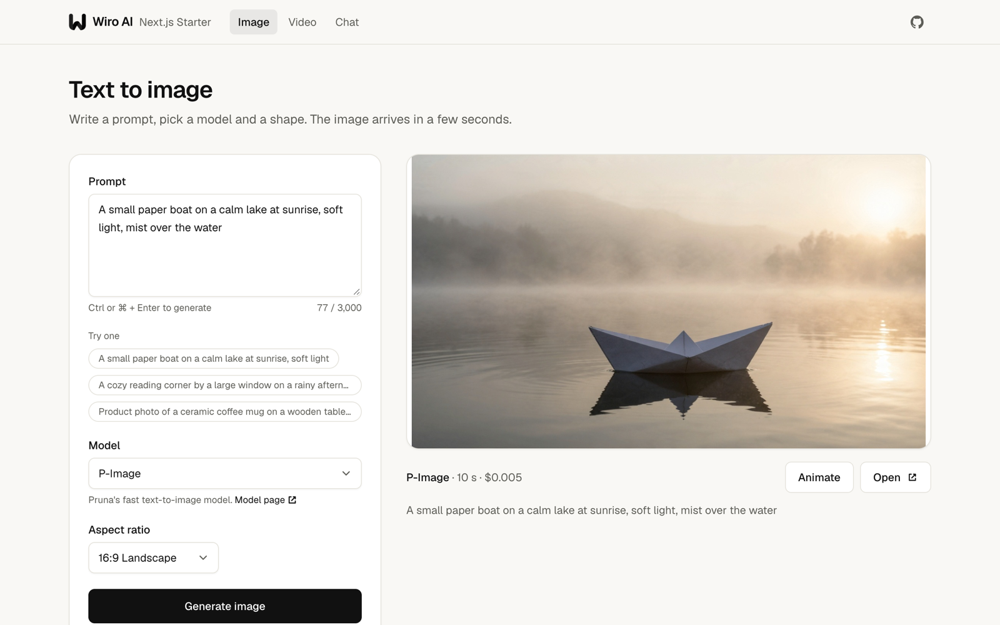
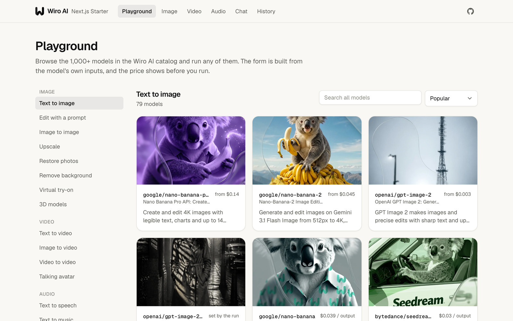
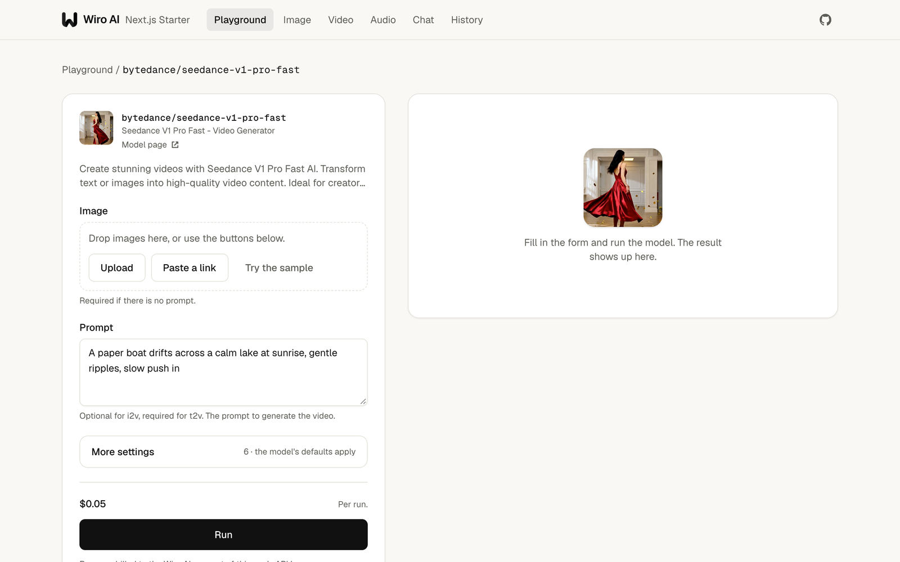
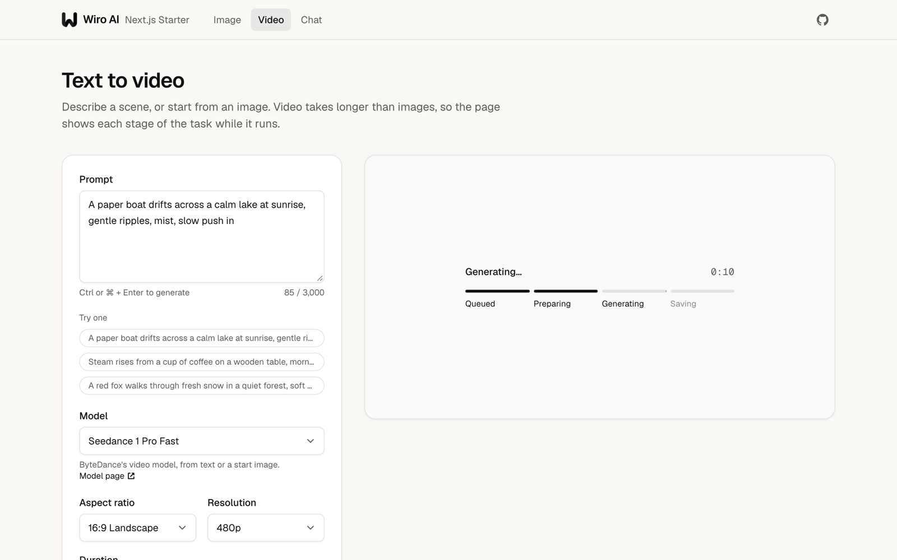
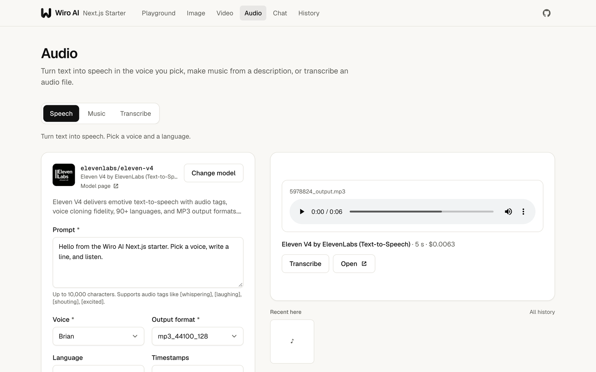
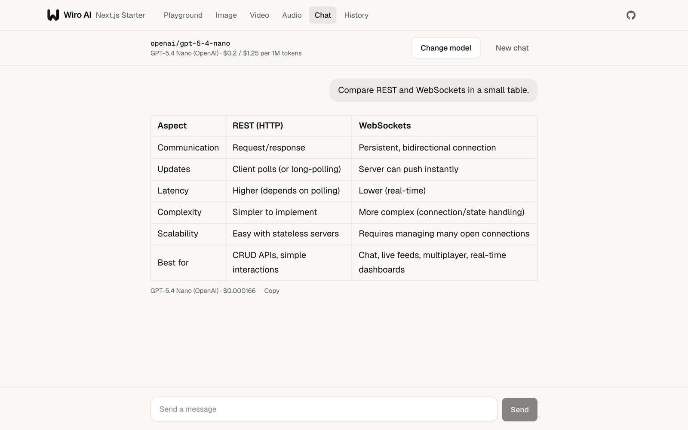
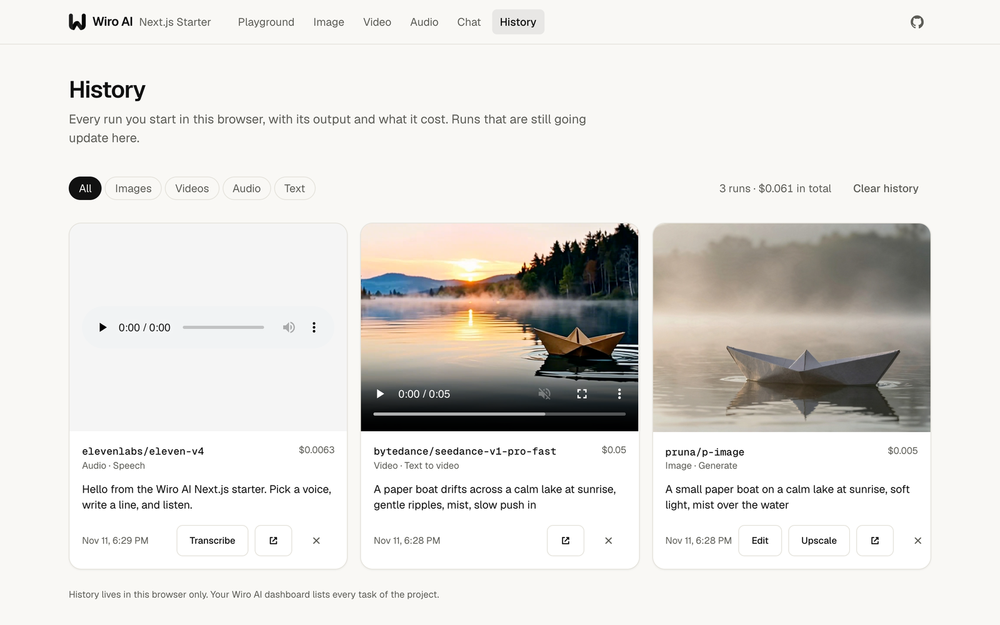

# Wiro AI Next.js Starter

<div align="center">


A Next.js app for the Wiro AI API: a Playground for any of the 1,000+ models, image, video and audio tools, a streaming LLM chat built with the Vercel AI SDK, and a history of your runs.

[](https://nextjs.org) [](https://ai-sdk.dev) [](https://github.com/wiroai/Wiro-Next-Starter/actions/workflows/ci.yml) [](./LICENSE)

[Website](https://wiro.ai) · [Models](https://wiro.ai/models) · [Docs](https://wiro.ai/docs) · [Dashboard](https://wiro.ai/panel)


[](https://vercel.com/new/clone?repository-url=https%3A%2F%2Fgithub.com%2Fwiroai%2FWiro-Next-Starter&env=WIRO_API_KEY&envDescription=API%20key%20of%20your%20Wiro%20AI%20project&envLink=https%3A%2F%2Fwiro.ai%2Fdocs%2Fauthentication&project-name=wiro-next-starter&repository-name=wiro-next-starter&demo-title=Wiro%20AI%20Next.js%20Starter&demo-description=Run%20any%20of%20the%201%2C000%2B%20Wiro%20AI%20models%20from%20a%20Next.js%20app%3A%20Playground%2C%20image%2C%20video%20and%20audio%20tools%2C%20LLM%20chat%20and%20history%2C%20with%20prices%20shown.&demo-url=https%3A%2F%2Fwiro-next-starter.vercel.app&demo-image=https%3A%2F%2Fraw.githubusercontent.com%2Fwiroai%2FWiro-Next-Starter%2Fmain%2Fapp%2Fopengraph-image.png) [](https://railway.com/deploy/d9X1ON?referralCode=oJDnIx&utm_medium=integration&utm_source=button&utm_campaign=wiro-next-starter)

</div>

This starter shows how to build on [Wiro AI](https://wiro.ai) with the Next.js App Router. Model lists come from the Wiro AI catalog by category, each model's form is built from its own inputs, and the price of a run shows before it starts. Images, video and audio go through the Wiro AI Run API, with files uploaded to Wiro AI first and the task followed until it ends. The chat streams from the Wiro LLM gateway with the AI SDK and [`@wiro-ai/wiro-llm`](https://github.com/wiroai/Wiro-LLM). Every call to Wiro AI runs in a route handler, so your API key never reaches the browser.



## What's inside

- **Playground.** Browse the catalog by category (text to image, editing, upscaling, background removal, video, speech, music, transcription, OCR and more) or search all of it, then run any model. The form comes from the model's schema, with its advanced settings folded away and its sample input one click away.
- **Image.** Generate, Edit with a prompt, Upscale and Remove background. Each tool starts on a default model and lists every model of its category.
- **Video.** Text to video and Image to video, with each stage of the task and a timer while it runs.
- **Audio.** Speech in any voice and language the model offers, Music from a description, and Transcribe for audio files.
- **Chat.** Every chat model on the Wiro LLM gateway, with search and prices per million tokens, streamed with `useChat`, with Markdown answers and the cost of each reply.
- **History.** Your runs in this browser with their outputs and costs. Runs that are still going update on their own.
- **One result into the next tool.** An image goes on to Edit, Upscale, Remove background or Animate in one click, and a speech file to Transcribe.
- **The price before each run,** worked out from the model's price list the way Wiro AI bills it, and the billed amount after.
- **Ready to deploy.** Calls only from route handlers, every request checked against the model's inputs, an optional password for the whole app and an optional price limit per run.
- **An agent skill** for coding agents, with tested samples for keys, prices, tasks, webhooks and chat. See [Agent skill](#agent-skill).
- Next.js 16 with the App Router and Cache Components, React 19, TypeScript, Tailwind CSS 4, AI SDK 7, light and dark themes, ESLint, Prettier and Vitest.

## Deploy

You need a Wiro AI project. Create one at [wiro.ai/panel/project/new](https://wiro.ai/panel/project/new) and copy its API key. If you choose signature authentication for the project, copy the API secret too.

### Deploy with Vercel

Click **Deploy with Vercel** above. Vercel copies this repository to your GitHub account, asks for `WIRO_API_KEY` and deploys the app. For a signature project, add `WIRO_API_SECRET` afterwards under **Settings → Environment Variables** and redeploy. The other settings in [Environment variables](#environment-variables) are optional.

### Deploy on Railway

Click **Deploy on Railway** above. Railway opens the template, asks for `WIRO_API_KEY` and deploys the app. For a signature project, fill in `WIRO_API_SECRET` as well. The other variables are optional (see [Environment variables](#environment-variables)).

To deploy your own fork instead, choose **New Project → Deploy from GitHub repo** in Railway and pick the fork, add `WIRO_API_KEY` under **Variables**, then click **Generate Domain** under **Settings → Networking**.

Railway builds the app with Railpack, which reads `package.json`: it runs `npm run build`, starts the app with `npm start` and takes the Node.js version from `engines`. `next start` listens on the `PORT` that Railway sets, so no Railway config file is needed. If you add a healthcheck, use `/`.

### Other hosts

`npm run build` and `npm start` run the app on any host with Node.js 22 or later.

### Run a public demo

Anyone who can open a deployment can run models with its key. For a demo that strangers can try:

1. In your Wiro AI dashboard, create a team for the demo, move a small amount to its wallet and set a team spend limit. You can also limit the models the team can run. See [Team billing](https://wiro.ai/docs/organizations-billing).
2. Create a project in that team and use its API key as `WIRO_API_KEY`.
3. Set `MAX_RUN_PRICE`, for example to `0.10`, so no single run costs more.
4. Leave `BASIC_AUTH_PASSWORD` empty so visitors can open the app.

For a deployment only you use, set `BASIC_AUTH_PASSWORD` instead.

## Run it locally

```bash
git clone https://github.com/wiroai/Wiro-Next-Starter.git
cd Wiro-Next-Starter
npm install
cp .env.example .env.local
```

Put your key in `.env.local`, then start the dev server and open [http://localhost:3000](http://localhost:3000):

```bash
npm run dev
```

## Environment variables

| Variable              | Required               | What it does                                                                                                                             |
| --------------------- | ---------------------- | ---------------------------------------------------------------------------------------------------------------------------------------- |
| `WIRO_API_KEY`        | Yes                    | API key of your Wiro AI project                                                                                                          |
| `WIRO_API_SECRET`     | For signature projects | API secret of the same project. Run API requests are signed with it, and the LLM gateway gets `API_KEY:API_SECRET`                       |
| `BASIC_AUTH_PASSWORD` | No                     | When set, the browser asks for this password before it opens any page. Any user name works                                               |
| `MAX_RUN_PRICE`       | No                     | The most one run may cost, in USD, such as `0.10`. Runs that cost more, or have no price set before the run, are refused                 |
| `MAX_UPLOAD_MB`       | No                     | The largest file the upload route takes, 25 by default. Vercel functions accept request bodies up to 4.5 MB, so use a link for big files |

The app reads these on the server when a request comes in, so a build works without them. None of them starts with `NEXT_PUBLIC_`, so Next.js never sends them to the browser.

## How it works

```text
Browser                           This app (route handlers)                Wiro AI
GET  /api/models?categories=  ->  catalog, cached for 10 minutes      ->   POST /Tool/List
GET  /api/models/{owner}/{id} ->  inputs and price list               ->   POST /Tool/Detail
POST /api/uploads             ->  store the file                      ->   POST /File/Upload
POST /api/runs                ->  check the form, price, limit        ->   POST /Run/{owner}/{model}
                              <-  { token, price }
GET  /api/tasks/{token}       ->  stage, outputs, text, cost          ->   POST /Task/Detail
POST /api/chat                ->  streamText(wiro(model))             ->   llm.wiro.ai/v1/chat/completions
```

| Route                              | What it does                                                                                                                                                  |
| ---------------------------------- | ------------------------------------------------------------------------------------------------------------------------------------------------------------- |
| `app/api/models`                   | Lists the models of one or more categories from the [catalog](https://wiro.ai/docs/models), or searches all of it. Hidden models are left out.                |
| `app/api/models/[owner]/[project]` | One model's inputs and price list.                                                                                                                            |
| `app/api/uploads`                  | Stores a file from the browser with Wiro AI and returns its URL, which the form sends as a file input.                                                        |
| `app/api/runs`                     | Checks the form against the model's inputs, prices the run, applies `MAX_RUN_PRICE` and starts the task with [`POST /Run`](https://wiro.ai/docs/run-a-model). |
| `app/api/tasks/[token]`            | Reads the task with [`POST /Task/Detail`](https://wiro.ai/docs/tasks): its stage, output files, text answer, time and cost.                                   |
| `app/api/chat/models`              | The chat models on the [Wiro LLM gateway](https://wiro.ai/docs/completions-api), with their prices.                                                           |
| `app/api/chat`                     | Streams a reply with `streamText` and `@wiro-ai/wiro-llm`, and adds the model and cost to the message metadata.                                               |
| `app/api/config`                   | The limits the page shows before a run. It never returns the key.                                                                                             |

The code behind them:

| File                     | What it does                                                                                                                                             |
| ------------------------ | -------------------------------------------------------------------------------------------------------------------------------------------------------- |
| `lib/catalog/schema.ts`  | Reads a model's inputs and turns form values into Run parameters: file inputs and their URL fields, checkboxes, ranges and defaults. Runs on both sides. |
| `lib/catalog/pricing.ts` | Prices a run from the model's price list the way Wiro AI bills it: per run, per output, per character, per second of audio or video, or by run time.     |
| `lib/catalog/tools.ts`   | The tools of the Image, Video and Audio pages with their categories and default models, and the Playground's categories.                                 |
| `lib/catalog/filters.ts` | Models the app never lists: uncensored and NSFW models, and live voice models that need a realtime connection.                                           |
| `lib/wiro/`              | Server only: the Run API client with request signing, the catalog cache, the gateway model list and the limits.                                          |
| `lib/use-task-run.ts`    | The React hook that starts a task and polls it.                                                                                                          |
| `lib/history.ts`         | The History page's store in `localStorage`.                                                                                                              |
| `proxy.ts`               | The optional password.                                                                                                                                   |

A task is finished when its status is `task_postprocess_end`, with `pexit` `"0"` on success, or `task_cancel`; see [Tasks](https://wiro.ai/docs/tasks). The browser only ever gets the task token, never the numeric task ID. Projects that use signature authentication send `x-nonce` and `x-signature` with every Run API request, where the signature is HMAC-SHA256 of the API secret plus the nonce, keyed with the API key; see [Authentication](https://wiro.ai/docs/authentication).

## Tools and default models

| Page  | Tool              | Lists the models of                 | Starts on                        |
| ----- | ----------------- | ----------------------------------- | -------------------------------- |
| Image | Generate          | `text-to-image`                     | `pruna/p-image`                  |
| Image | Edit              | `image-editing`                     | `google/nano-banana-2`           |
| Image | Upscale           | `upscale`, `restoration`            | `xinntao/real-esrgan`            |
| Image | Remove background | `background-removal`                | `briaai/rmbg-2-0`                |
| Video | Text to video     | `text-to-video`                     | `bytedance/seedance-v1-pro-fast` |
| Video | Image to video    | `image-to-video`                    | `bytedance/seedance-v1-pro-fast` |
| Audio | Speech            | `text-to-speech`                    | `elevenlabs/eleven-v4`           |
| Audio | Music             | `text-to-music`, `music-generation` | `elevenlabs/text-to-music-v2-5`  |
| Audio | Transcribe        | `speech-to-text`                    | `elevenlabs/speech-to-text`      |
| Chat  |                   | the Wiro LLM gateway                | `openai/gpt-5-4-nano`            |

**Change model** on any tool lists the other models of its categories with their prices. Links can open a tool on a model and a file: `/image?tab=edit&model=openai/gpt-image-2&image=https://...`

### Customize

- **Add a tool:** add an entry to `TOOLS` in `lib/catalog/tools.ts` with its page, Wiro categories and default model. It shows up as a tab on that page.
- **Change the Playground's categories:** edit `CATEGORY_GROUPS` in the same file. The [catalog](https://wiro.ai/models) shows every category.
- **Hide more models:** extend `isHiddenModel` in `lib/catalog/filters.ts`.
- **Change the look:** the colors are CSS variables at the top of `app/globals.css`, with a dark set for `prefers-color-scheme: dark`.

## Agent skill

The repository ships an agent skill, [`wiro-nextjs`](skills/wiro-nextjs/SKILL.md), that teaches coding agents such as Claude Code, Cursor and Codex to build on Wiro AI in a Next.js app: the API key in route handlers and server actions, models and their prices from the catalog, tasks followed by polling or a webhook, file uploads, image, video and speech runs, and chat through the LLM gateway. It also maps the files of this starter. Install it in your project with:

```bash
npx skills add wiroai/Wiro-Next-Starter --skill wiro-nextjs
```

Every code sample in the skill is also a file in `skills/wiro-nextjs/examples`, which `npm run typecheck` checks against the code of this repository, and `tests/skill.test.ts` keeps the two copies the same.

## Screenshots













## Development

```bash
npm run dev        # dev server on http://localhost:3000
npm run check      # format check, lint, type check and tests
npm run build      # production build
npm start          # serve the production build
```

The tests cover the input handling and pricing, the catalog, the Run API client with request signing, task status mapping, every route handler, the password check and the code samples of the agent skill. They use a mocked `fetch` and make no network calls. CI runs them with the format check, lint, type check and build on Node.js 22 and 24.

## Costs

Each run is billed to the Wiro AI account of the API key at the model's price, which the app shows before the run and which is listed on the model's page. Only successful tasks are billed. The app shows the billed amount under every result and chat reply, and the History page adds them up.

## More from Wiro AI

| Repository                                                                   | What it is                                                                                                                                              |
| ---------------------------------------------------------------------------- | ------------------------------------------------------------------------------------------------------------------------------------------------------- |
| [Wiro-MCP](https://github.com/wiroai/Wiro-MCP)                               | Official MCP server for Wiro AI, [`@wiro-ai/wiro-mcp` on npm](https://www.npmjs.com/package/@wiro-ai/wiro-mcp)                                          |
| [Wiro-LLM](https://github.com/wiroai/Wiro-LLM)                               | Vercel AI SDK provider for chat, images, speech, transcription and video, [`@wiro-ai/wiro-llm` on npm](https://www.npmjs.com/package/@wiro-ai/wiro-llm) |
| [Wiro-Plugin](https://github.com/wiroai/Wiro-Plugin)                         | Wiro AI plugin for Cursor, Claude Code, Gemini CLI, Devin, Antigravity and Kiro                                                                         |
| [Wiro-Skills](https://github.com/wiroai/Wiro-Skills)                         | Agent skills for images, image edits, video, music, speech, transcripts, 3D and model search                                                            |
| [Wiro-Chromium-Extension](https://github.com/wiroai/Wiro-Chromium-Extension) | Wiro AI extension for Chrome, Edge, Opera and Brave                                                                                                     |
| [Wiro-Firefox-Extension](https://github.com/wiroai/Wiro-Firefox-Extension)   | Wiro AI add-on for Firefox                                                                                                                              |
| [Wiro-Safari-Extension](https://github.com/wiroai/Wiro-Safari-Extension)     | Wiro AI extension for Safari on the Mac                                                                                                                 |
| [Swift-QuickStart](https://github.com/wiroai/Swift-QuickStart)               | WiroKit, the Wiro AI SDK for iOS                                                                                                                        |
| [Kotlin-QuickStart](https://github.com/wiroai/Kotlin-QuickStart)             | WiroKit, the Wiro AI SDK for Android                                                                                                                    |
| [Dart-QuickStart](https://github.com/wiroai/Dart-QuickStart)                 | Wiro AI SDK for Dart and Flutter, [`wiro` on pub.dev](https://pub.dev/packages/wiro)                                                                    |
| [ReactNative-QuickStart](https://github.com/wiroai/ReactNative-QuickStart)   | Wiro AI SDK for React Native and Expo, [`@wiro-ai/wiro-react-native` on npm](https://www.npmjs.com/package/@wiro-ai/wiro-react-native)                  |
| [Swift-Realtime](https://github.com/wiroai/Swift-Realtime)                   | Realtime voice AI example for iOS                                                                                                                       |
| [Kotlin-Realtime](https://github.com/wiroai/Kotlin-Realtime)                 | Realtime voice AI example for Android                                                                                                                   |
| [Dart-Realtime](https://github.com/wiroai/Dart-Realtime)                     | Realtime voice AI example for Flutter                                                                                                                   |
| [ReactNative-Realtime](https://github.com/wiroai/ReactNative-Realtime)       | Realtime voice AI example for React Native                                                                                                              |
| [n8n-nodes-wiroai](https://github.com/wiroai/n8n-nodes-wiroai)               | Wiro AI nodes for n8n, [`@wiro-ai/n8n-nodes-wiroai` on npm](https://www.npmjs.com/package/@wiro-ai/n8n-nodes-wiroai)                                    |
| [Wiro-Dify-Plugin](https://github.com/wiroai/Wiro-Dify-Plugin)               | Wiro AI plugins for Dify: the LLM gateway as a model provider, plus image, video, speech and music tools                                                |
| [Wiro-ComfyUI](https://github.com/wiroai/Wiro-ComfyUI)                       | Wiro AI nodes for ComfyUI                                                                                                                               |
| [Wiro-Hermes](https://github.com/wiroai/Wiro-Hermes)                         | Wiro AI plugins for Hermes Agent: image, video, audio and 3D tools, plus the LLM gateway as a model provider                                            |
| [Wiro-Zed](https://github.com/wiroai/Wiro-Zed)                               | Wiro AI MCP server extension for Zed                                                                                                                    |
| [Wiro-Action](https://github.com/wiroai/Wiro-Action)                         | GitHub Action for Wiro AI models and the LLM gateway, [on the GitHub Marketplace](https://github.com/marketplace/actions/wiro-ai-action)                |
| [Wiro-Raycast](https://github.com/wiroai/Wiro-Raycast)                       | Wiro AI extension for Raycast: image and video generation, LLM chat and model search                                                                    |
| [Wiro-WordPress](https://github.com/wiroai/Wiro-WordPress)                   | Wiro AI plugin for WordPress: featured images, image edits, alt text, narration and SEO suggestions                                                     |
| [Wiro-Obsidian](https://github.com/wiroai/Wiro-Obsidian)                     | Wiro AI plugin for Obsidian: images, video, speech, music, transcription and text tools                                                                 |
| [Wiro-Blender](https://github.com/wiroai/Wiro-Blender)                       | Wiro AI add-on for Blender: text to 3D, image to 3D and textures                                                                                        |
| [Wiro-Figma](https://github.com/wiroai/Wiro-Figma)                           | Wiro AI plugin for Figma: images, vectors, image edits and text                                                                                         |
| [Wiro-Docs](https://github.com/wiroai/Wiro-Docs)                             | Source of the Wiro AI API docs                                                                                                                          |

[Website](https://wiro.ai) · [Models](https://wiro.ai/models) · [Docs](https://wiro.ai/docs) · [X](https://x.com/wiroai)

## License

MIT, see [LICENSE](./LICENSE).
